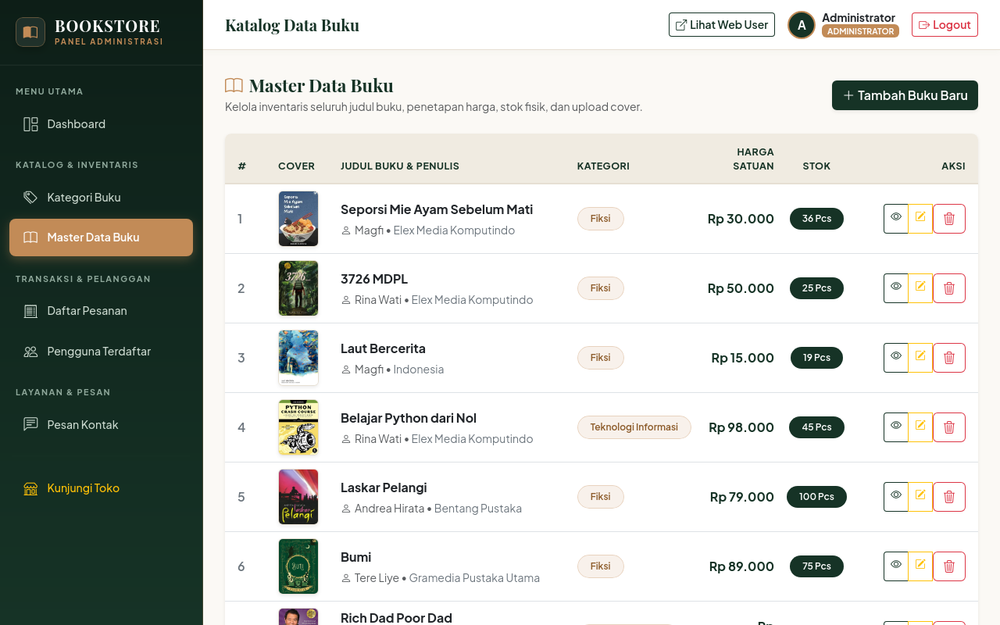
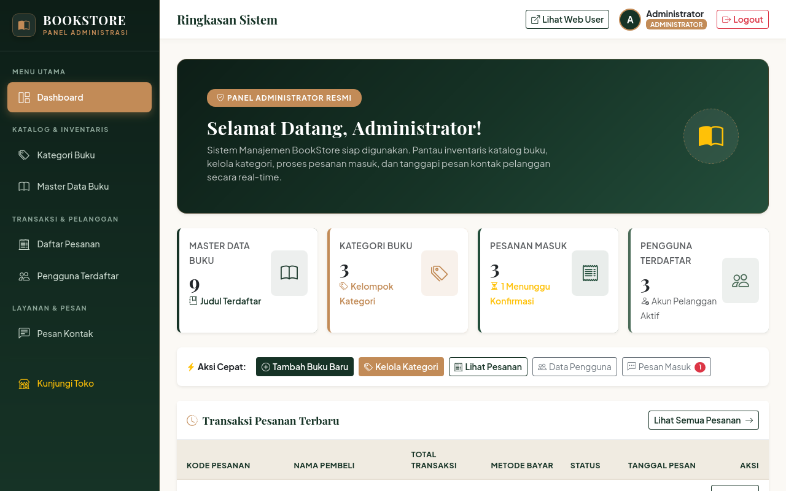
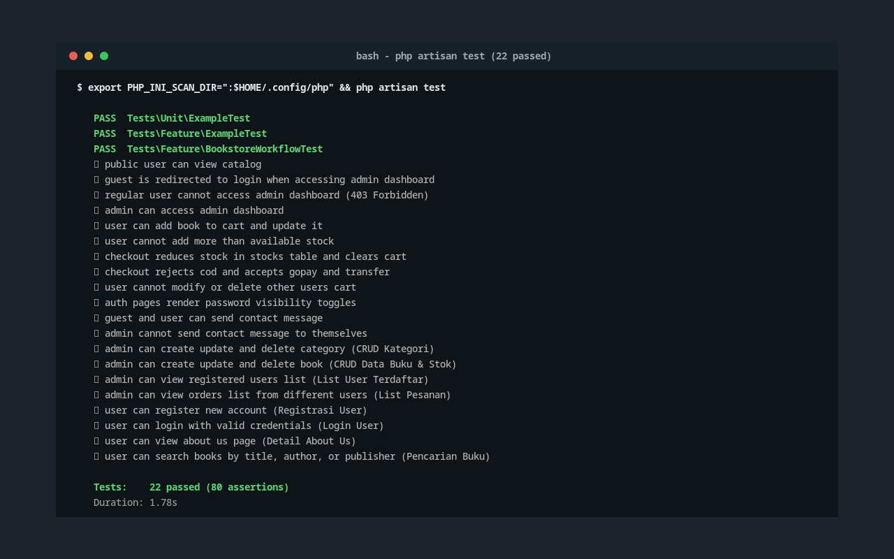

# 📸 Galeri Screenshot Halaman Web - BookStore USK

Folder ini berisi dokumentasi tangkapan layar (*screenshots*) dari seluruh antarmuka web BookStore, mencakup halaman publik, fitur transaksi pelanggan, panel administrator, desain Figma mockup, hingga hasil pengujian unit otomatis.

---

## 📑 Daftar Halaman & Screenshot

| No | Nama Halaman / Fitur | Berkas Screenshot | Deskripsi Singkat |
|:---:|:---|:---|:---|
| 01 | **Halaman Utama & Katalog** | [`01_halaman_utama_katalog.png`](01_halaman_utama_katalog.png) | Beranda modern, Hero banner, dan daftar buku pilihan |
| 02 | **Pencarian & Filter Buku** | [`02_pencarian_katalog.png`](02_pencarian_katalog.png) | Fitur pencarian buku berdasarkan judul/penulis & filter kategori |
| 03 | **Detail Buku** | [`03_detail_buku.png`](03_detail_buku.png) | Informasi lengkap buku, stok fisik, penerbit, dan tombol Add to Cart |
| 04 | **Tentang Kami (About Us)** | [`04_tentang_kami_about.png`](04_tentang_kami_about.png) | Profil toko buku, visi misi, dan keunggulan layanan |
| 05 | **Kontak Layanan (Contact Us)** | [`05_kontak_hubungi_kami.png`](05_kontak_hubungi_kami.png) | Formulir pengiriman pesan/pertanyaan dari pengunjung ke admin |
| 06 | **Keranjang Belanja (Cart)** | [`06_keranjang_belanja.png`](06_keranjang_belanja.png) | Daftar buku yang dipilih, pengaturan jumlah, dan total harga |
| 07 | **Checkout & Pembayaran** | [`07_checkout_pembayaran.png`](07_checkout_pembayaran.png) | Formulir data pengiriman dan opsi bayar (Transfer, E-Wallet, COD) |
| 08 | **Riwayat Pesanan Pelanggan** | [`08_riwayat_pesanan_user.png`](08_riwayat_pesanan_user.png) | Riwayat invoice transaksi pembeli dan status pesanan terkini |
| 09 | **Registrasi Pengguna Baru** | [`09_registrasi_pengguna.png`](09_registrasi_pengguna.png) | Formulir pendaftaran akun pembeli dengan validasi ketat |
| 10 | **Halaman Login Pengguna** | [`10_login_pengguna.png`](10_login_pengguna.png) | Form masuk akun dengan toggle lihat/sembunyikan password |
| 11 | **Dashboard Administrator** | [`11_admin_dashboard.png`](11_admin_dashboard.png) | Panel statistik ringkasan total buku, kategori, pesanan, dan user |
| 12 | **Manajemen Kategori (Admin)** | [`12_admin_manajemen_kategori.png`](12_admin_manajemen_kategori.png) | Operasi CRUD kelompok kategori buku |
| 13 | **Master Data Buku & Stok (Admin)** | [`13_admin_manajemen_buku.png`](13_admin_manajemen_buku.png) | Tabel inventaris buku, upload cover asli, harga, dan kontrol stok |
| 14 | **Manajemen Pengguna (Admin)** | [`14_admin_manajemen_pengguna.png`](14_admin_manajemen_pengguna.png) | Daftar akun pengguna terdaftar dengan peran User dan Administrator |
| 15 | **Manajemen Pesanan (Admin)** | [`15_admin_manajemen_pesanan.png`](15_admin_manajemen_pesanan.png) | Pemantauan seluruh invoice pesanan dan pembaruan status |
| 16 | **Pesan Masuk Kontak (Admin)** | [`16_admin_pesan_masuk.png`](16_admin_pesan_masuk.png) | Daftar pesan masuk dari pengunjung dengan fitur balas email |
| 17 | **Pengujian PHPUnit (22 Passed)** | [`17_terminal_phpunit_test_pass.png`](17_terminal_phpunit_test_pass.png) | Bukti eksekusi automated test lolos 100% (22/22 unit tests) |
| 18 | **Desain Mockup UI Figma** | [`18_figma_mockup_design.png`](18_figma_mockup_design.png) | Desain prototipe antarmuka UI/UX di Figma |

---

## 🖼️ Pratinjau Visual (Preview)

### 1. Halaman Utama / Katalog Publik

### 2. Master Data Buku (Admin Panel)

### 3. Dashboard Administrator

### 4. Hasil Pengujian Otomatis (PHPUnit 22 Passed)

